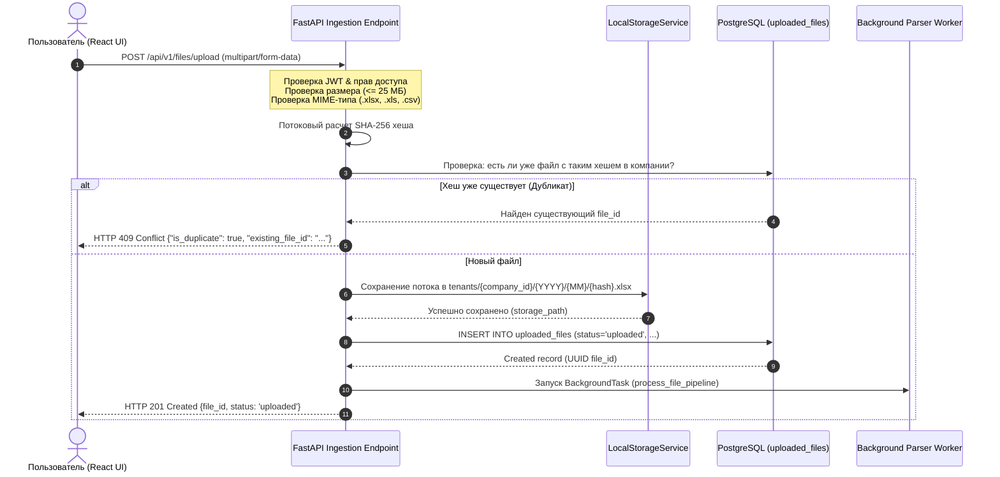

# Стратегия хранения и управления файлами (Storage & Files Strategy)
## Проект: Smart Enterprise Hub (MVP)

В данном документе описывается архитектура подсистемы хранения файлов: жизненный цикл загрузки, организация файловой структуры, абстракция хранилища (Local Volume vs Cloud S3) и политика дедупликации.

---

## 1. Архитектурная концепция: «S3-Ready Local Storage»

Для запуска MVP с нулевыми затратами на сторонние облачные сервисы и без развертывания тяжелых контейнеров (таких как MinIO, требующих > 350 МБ RAM) применяется архитектурный паттерн **Storage Adapter**.

```
┌────────────────────────────────────────────────────────┐
│               FastAPI Application Layer                │
│                 (File Management API)                  │
└──────────────────────────┬─────────────────────────────┘
                           │ вызывает
                           ▼
┌────────────────────────────────────────────────────────┐
│             Абстрактный интерфейс IStorageService       │
│  - save_file(stream, key)                              │
│  - get_file(key) -> bytes                              │
│  - delete_file(key) -> bool                            │
│  - get_download_url(key, expires_in) -> str            │
└──────────────────────────┬─────────────────────────────┘
                           │
             ┌─────────────┴─────────────┐
             ▼                           ▼
┌──────────────────────────┐┌────────────────────────────┐
│   LocalStorageService    ││      S3StorageService      │
│  (АКТИВЕН В MVP — 0 ₽)   ││   (ГОТОВ ДЛЯ SCALE PHASE)  │
│ - Сохранение в том Docker││ - Яндекс Object Storage /  │
│   /app/data/uploads      ││   Selectel / AWS S3        │
│ - Защищенная отдача      ││ - Временные presigned URL  │
│   через FastAPI Stream   ││                            │
└──────────────────────────┘└────────────────────────────┘
```

### Преимущества подхода:
1. **0 рублей расходов**: Хранение осуществляется на доступном NVMe-диске арендованного VPS (20–30 ГБ достаточно для сотен тысяч Excel-документов).
2. **Чистая архитектура (Clean Architecture)**: Бизнес-логика ничего не знает о физическом диске.
3. **Бесшовный переезд в S3**: При росте проекта в конфигурационном файле меняется параметр `STORAGE_DRIVER=s3`, указываются ключи доступа, и приложение работает с облаком без правок в коде.

---

## 2. Иерархия файлового хранилища

Для исключения переполнения каталогов в файловой системе Linux и строгой изоляции клиентов используется шардированная структура каталогов:

```
/app/data/uploads/
└── tenants/
    ├── {company_uuid_1}/
    │   └── 2026/
    │       ├── 10/
    │       │   ├── e3b0c44298fc1c149afbf4c8996fb924.xlsx
    │       │   └── 7f83b1657ff1fc53b92dc18148a1d65d.xlsx
    │       └── 11/
    │           └── ...
    └── {company_uuid_2}/
        └── 2026/
            └── ...
```

### Правила именования:
- **Ключ файла (`storage_path`)**: `tenants/{company_id}/{YYYY}/{MM}/{sha256_hash}{extension}`.
- Исходное имя файла (например, `«Отчет по КС-2 Октябрь финал.xlsx»`) сохраняется в таблице БД `uploaded_files.original_name` и никогда не используется как имя на диске (защита от атак Directory Traversal и проблем с кодировками UTF-8 в файловых системах).

---

## 3. Полный жизненный цикл загрузки файла (Ingestion Flow)



---

## 4. Контракт интерфейса `IStorageService` (Python)

```python
from abc import ABC, abstractmethod
from typing import BinaryIO

class IStorageService(ABC):
    """Абстрактный интерфейс сервиса хранения файлов."""

    @abstractmethod
    async def save_file(self, file_obj: BinaryIO, storage_key: str) -> str:
        """Сохранить файл в хранилище. Возвращает сохраненный путь/ключ."""
        pass

    @abstractmethod
    async def get_file_stream(self, storage_key: str) -> BinaryIO:
        """Получить файловый поток для чтения/парсинга."""
        pass

    @abstractmethod
    async def delete_file(self, storage_key: str) -> bool:
        """Удалить файл из хранилища."""
        pass

    @abstractmethod
    async def file_exists(self, storage_key: str) -> bool:
        """Проверить существование файла."""
        pass
```

---

## 5. Политика хранения, очистки и безопасности

1. **Защита от скачивания чужих файлов (No IDOR)**:
   - Файлы **никогда не раздаются напрямую через статический Nginx-каталог**.
   - Скачивание оригинального файла происходит исключительно через эндпоинт `GET /api/v1/files/{file_id}/download`, который:
     1. Проверяет авторизацию пользователя и принадлежность файла его `company_id`.
     2. Отдает файл с правильным заголовком `Content-Disposition: attachment; filename="<original_name>"`.
2. **Мягкое и жесткое удаление (Soft Delete & Cleanup)**:
   - При удалении документа пользователем в БД выставляется `deleted_at = NOW()`.
   - Фоновая задача (раз в неделю) находит файлы, помеченные удаленными более 30 дней назад, и физически удаляет их с диска.
3. **Лимиты компании**:
   - В MVP для одной компании установлен лимит в **1 000 файлов** или **5 ГБ** суммарного дискового пространства. При приближении к лимиту (90%) администратор получает системное предупреждение.
