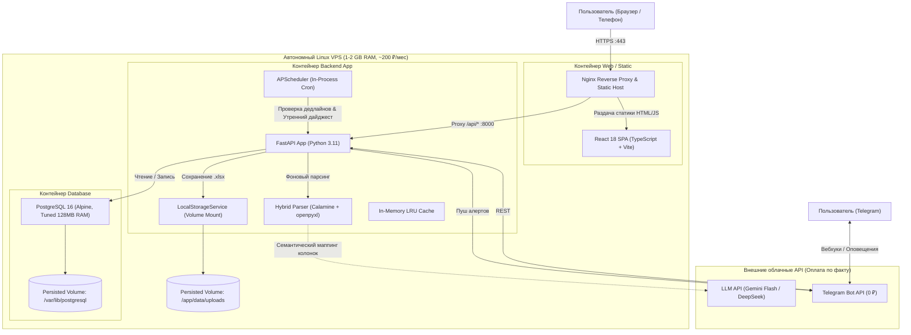

# Архитектурные решения по технологическому стеку (Technology Stack ADR)
## Проект: Smart Enterprise Hub (MVP)

В данном документе формализованы ключевые архитектурные решения (Architectural Decision Records — ADR), принятые для реализации MVP-версии платформы. Решения оптимизированы под критерии: **минимальная стоимость владения (0–300 ₽/мес)**, **высокая скорость разработки**, **надежность** и **отсутствие оверинжиниринга**.

---

## 1. Сводная таблица стека технологий

| Слой системы | Выбранная технология | Обоснование выбора | Альтернативы и причина отказа |
| :--- | :--- | :--- | :--- |
| **Frontend** | **React 18 + TypeScript + Vite** | Де-факто отраслевой стандарт. Строгая типизация моделей данных, богатая экосистема компонентов дашбордов, молниеносная сборка через Vite, нулевое потребление ресурсов сервера (статическая раздача). | *Vue 3 / Svelte*: Отличные фреймворки, но React имеет больше готовых готовых enterprise-библиотек (Recharts, TanStack Table). |
| **Frontend UI/Стили** | **Tailwind CSS + Lucide Icons + Radix UI** | Обеспечивает премиальный визуальный стиль («дарк-мод», аккуратные карточки, микроанимации как в лучших референсах) без тяжелых зависимостей. Размер бандла < 50 КБ CSS. | *MUI / Ant Design*: Избыточный вес бандла (over 500 KB), устаревший визуальный шаблон. |
| **Backend API** | **Python 3.11+ / FastAPI** | Нативная поддержка лучших в мире библиотек парсинга таблиц и ИИ-экосистемы. Асинхронный I/O (ASGI), строгая валидация Pydantic v2, автогенерация Swagger/OpenAPI. Потребление памяти в покое: 80–120 МБ. | *Node.js (NestJS)*: Потребовал бы сторонних мостов к Python для сложного парсинга Excel и ИИ. *Go*: Медленнее в прототипировании, бедная экосистема работы с Excel-формулами. |
| **База данных** | **PostgreSQL 16 (в Docker)** | Мощнейшая реляционная СУБД с превосходной поддержкой JSONB (для гибких схем таблиц и кэша шаблонов), строгой ссылочной целостностью, надежными транзакциями ACID и готовыми инструментами аналитики. | *SQLite*: Отлична для локальных тестов, но имеет ограничения на параллельную запись и менее гибка в JSONB-индексах. |
| **ORM / Драйвер БД** | **SQLAlchemy 2.0 (Async) + asyncpg** | Асинхронная работа с PostgreSQL, надежные миграции через Alembic, строгая типизация сущностей. | *Tortoise-ORM / Peewee*: Меньшее комьюнити, меньше возможностей сложных агрегаций. |
| **Хранилище файлов** | **Локальный Docker Volume + S3 Adapter Pattern** | Нулевая стоимость. Файлы пишутся в локальную смонтированную директорию NVMe-диска сервера. Код изолирован через интерфейс `IStorageService`, что позволяет переключиться на S3 (Яндекс/Selectel) сменой 1 переменной окружения. | *MinIO*: Потребляет от 350 МБ RAM сервера (недопустимо на 1 ГБ VPS). *Платный S3*: Лишние постоянные расходы на старте. |
| **Очереди и задачи** | **FastAPI BackgroundTasks + APScheduler** | Выполнение асинхронного парсинга и периодических проверок (утренний Telegram-дайджест, проверка дедлайнов) прямо в процессе бэкенда. Нулевой оверхед по RAM. | *Celery + RabbitMQ / Redis*: Требуют 2 дополнительных контейнера и ~150 МБ RAM. Оправданы только при нагрузке > 100 000 файлов/день. |

---

## 2. Детальный разбор архитектурных решений (ADR)

### ADR-01: Выбор FastAPI как ядра бэкенда

- **Контекст**: Для проекта необходима обработка сложных Excel-таблиц (с объединенными ячейками, «грязными» суммами, датами), семантический маппинг колонок через LLM API, а также быстрый REST API для веб-дашборда.
- **Решение**: Использовать **FastAPI (Python 3.11+)**.
- **Преимущества**:
  1. **Единый технологический стек для API и аналитики**: Все библиотеки парсинга (`openpyxl`, `python-calamine` на базе Rust-ядра), валидаторы и официальные SDK для LLM (`google-genai`, `openai`, `deepseek`) являются первоклассными гражданами в Python.
  2. **Производительность**: FastAPI на базе `uvloop` и `Starlette` по скорости ввода-вывода сравним с Node.js и Go.
  3. **Pydantic v2**: Валидация входных JSON и схем Excel выполняется на компилированном Rust-ядре Pydantic с субмиллисекундной задержкой.
  4. **Автоматическая документация**: Интерактивные спецификации Swagger UI (`/docs`) и ReDoc генерируются автоматически «из коробки».

---

### ADR-02: Использование PostgreSQL 16 с тюнингом под сверхнизкие ресурсы

- **Контекст**: Пользователь выбрал реляционную СУБД **PostgreSQL**, при этом сервер имеет ограниченный объем RAM (1–2 ГБ).
- **Решение**: Запуск официального легковесного образа `postgres:16-alpine` в Docker с оптимизированным профилем настроек оперативной памяти (`low-memory tuning`):
  ```ini
  # postgresql.conf для 1-2 ГБ RAM VPS:
  shared_buffers = 128MB
  effective_cache_size = 384MB
  work_mem = 4MB
  maintenance_work_mem = 32MB
  min_wal_size = 100MB
  max_wal_size = 1GB
  max_connections = 25
  ```
- **Результат**: Потребление оперативной памяти PostgreSQL составляет стабильные **110–140 МБ**, гарантируя при этом 100% надежность транзакций ACID, параллельную обработку запросов и быстрые JSONB-индексы для маппинга колонок.

---

### ADR-03: Политика хранения файлов — Local Volume с паттерном Storage Adapter

- **Контекст**: Пользователю необходимо хранить исходные Excel-файлы (.xlsx) для истории, аудита и возможности повторной переразметки.
- **Решение**:
  - В коде бэкенда создается абстрактный интерфейс:
    ```python
    class IStorageService(ABC):
        async def save_file(self, content: bytes, file_path: str) -> str: ...
        async def get_file(self, file_path: str) -> bytes: ...
        async def delete_file(self, file_path: str) -> bool: ...
    ```
  - Для MVP по умолчанию работает **`LocalStorageService`**, сохраняющий файлы в локальный том Docker (`/app/data/uploads/...`).
  - Готов класс **`S3StorageService`** (через библиотеку `aioboto3`). При переходе в платное облако достаточно указать `STORAGE_TYPE=s3` в `.env`.
- **Экономия**: **0 рублей** затрат на S3 и **0 МБ** лишней памяти на MinIO.

---

### ADR-04: Исключение Redis из состава MVP (Zero-Overengineering)

- **Контекст**: Вопрос: стоит ли подключать Redis для кэширования и брокера задач?
- **Анализ**:
  1. *Сессии*: Реализуются через stateless JWT токены с подписью HS256/RS256. База данных и кэш не опрашиваются при проверке подписи токена.
  2. *Очереди задач*: В компании до 10 человек одновременно загружается не более 1–2 файлов. Механизм `BackgroundTasks` FastAPI и встроенный пул потоков (`asyncio.to_thread`) справляются с этим без внешнего брокера.
  3. *Кэширование дашборда*: Запросы к оптимизированной PostgreSQL выполняются за 5–20 мс. При необходимости кратковременный кэш горячих метрик реализуется через потокобезопасный in-memory LRU-кэш (`cachetools` с TTL 60 секунд) прямо в памяти Python.
- **Решение**: **Redis не включается в MVP**. Это экономит 50–70 МБ оперативной памяти и устраняет точку отказа. Интерфейс кэша оформляется через абстракцию `ICacheService` для безболезненного внедрения Redis в фазе масштабирования (Scale Phase).

---

## 3. Схема взаимодействия компонентов системы


