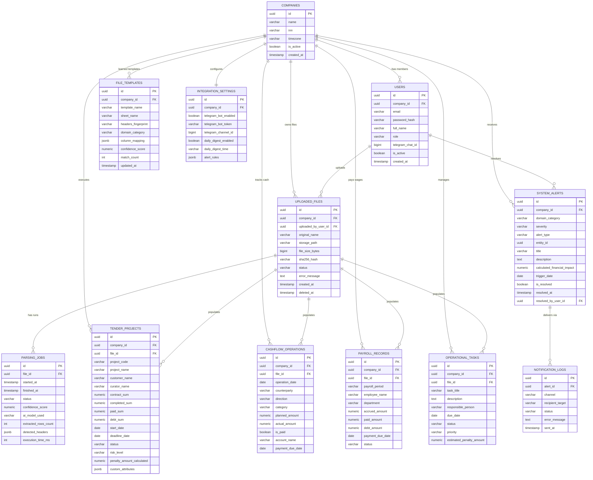

# Проектирование реляционной схемы базы данных (Database Schema)
## СУБД: PostgreSQL 16 | Проект: Smart Enterprise Hub (MVP)

В данном документе представлена архитектура реляционной базы данных для платформы. Схема спроектирована с учетом строгой изоляции мультиарендности (`company_id`), ссылочной целостности, высокой производительности аналитических запросов и гибкости за счет использования полей `JSONB`.

---

## 1. Концептуальные принципы моделирования

1. **Строгая мультиарендность (Tenant Isolation)**:
   - Каждая таблица бизнес-данных (`tender_projects`, `cashflow_operations`, `uploaded_files` и т.д.) содержит обязательный внешний ключ `company_id REFERENCES companies(id) ON DELETE CASCADE`.
   - Запросы выборки всегда индексируются с префиксом `company_id`, что гарантирует физическую невозможность утечки данных между организациями.
2. **Первичные ключи на базе UUID v4**:
   - Предотвращают подбор идентификаторов перебором (IDOR-атаки) и упрощают миграции/репликации данных в будущем.
3. **Двойной слой хранения (Реляционный + JSONB)**:
   - Ключевые показатели (суммы, даты, статусы, ответственные) хранятся в строгих типизированных колонках (`NUMERIC(15,2)`, `DATE`, `VARCHAR`), что гарантирует математическую точность и быстрые SQL-агрегации (`SUM`, `AVG`, `COUNT`).
   - Нестандартные атрибуты конкретного Excel-файла (например, *«Номер секции здания»*, *«Код субподрядчика»*) сохраняются в колонке `custom_attributes JSONB`, сохраняя гибкость без изменения схемы БД.
4. **Мягкое удаление (Soft Deletes)**:
   - Таблицы данных содержат поле `deleted_at TIMESTAMP NULL`. Удаленные документы и проекты не стираются физически сразу, что защищает от случайных ошибок пользователей.
5. **Аудит и временные метки**:
   - Каждая таблица содержит `created_at` и `updated_at` (поддерживается автоматическими триггерами PostgreSQL).

---

## 2. Диаграмма связей сущностей (Entity Relationship Diagram)

---

## 3. Детальный разбор доменных таблиц

### 3.1. Ядро мультиарендности и пользователей
- **`companies`**: Организация-клиент (арендатор). Хранит реквизиты, статус подписки, часовой пояс для корректной отправки утреннего дайджеста.
- **`users`**: Учетные записи сотрудников с разделением прав (`admin`, `manager`, `viewer`) и возможностью связки с Telegram аккаунтом.

### 3.2. Хранилище файлов и кэш схем парсинга
- **`uploaded_files`**: Реестр физических файлов с контрольной суммой SHA-256 для исключения дубликатов и статусом жизненного цикла (`uploaded` $\rightarrow$ `profiling` $\rightarrow$ `awaiting_confirmation` $\rightarrow$ `processed` / `failed`).
- **`file_templates`**: Ключевой компонент удешевления ИИ. Хранит отпечаток заголовков (`headers_fingerprint`) и подтвержденный маппинг колонок (`column_mapping`). При повторной загрузке файла маппинг применяется мгновенно с 0 затрат на LLM.
- **`parsing_jobs`**: Журнал сессий обработки таблиц. Позволяет мониторить время выполнения, точность модели (`confidence_score`) и расследовать сбои.

### 3.3. Канонические бизнес-домены (Canonical Data Models)
- **`tender_projects` (Домен 1: Производство и тендеры)**: Учет объектов строительства/контрактов. Позволяет рассчитывать отставание по срокам, остаток дебиторки и прогнозируемый штраф.
- **`cashflow_operations` (Домен 2: Финансы и касса)**: Реестр приходов и расходов. Обеспечивает построение графика ликвидности и выявление кассовых разрывов.
- **`payroll_records` (Домен 3: ФОТ и кадры)**: Фонд оплаты труда по подразделениям и сотрудникам. Позволяет отслеживать задолженность по зарплате перед коллективом.
- **`operational_tasks` (Домен 4: Поручения и комплаенс)**: Контрольные точки, сдача отчетов, продление банковских гарантий.

### 3.4. Риски, алерты и интеграции
- **`system_alerts`**: Централизованный реестр выявленных инцидентов (`CRITICAL`, `WARNING`, `INFO`). Хранит точный расчет ущерба (`calculated_financial_impact`), статус решения и ответственного.
- **`notification_logs`**: История рассылки в Telegram, браузерные пуши и Email.
- **`integration_settings`**: Настройки интеграции компании (токен Telegram-бота, время утренней рассылки, пороговые значения срабатывания тревог).

---

## 4. Стратегия индексов и оптимизация производительности

Для гарантии выборки данных дашборда быстрее 25 мс создаются специализированные индексы:

1. **Композитные индексы для фильтрации по компании**:
   - `idx_tender_projects_company_status`: `(company_id, status, deadline_date)`
   - `idx_cashflow_company_date`: `(company_id, operation_date, direction)`
   - `idx_alerts_company_unresolved`: `(company_id, is_resolved, severity)` — критически важен для мгновенной отрисовки счетчика алертов на колокольчике.
2. **Индексы дедупликации**:
   - `idx_files_company_hash`: `(company_id, sha256_hash)` — обеспечивает мгновенную проверку при Drag-and-Drop загрузке.
   - `idx_templates_lookup`: `(company_id, headers_fingerprint)` — быстрый поиск в кэше шаблонов за 1 мс.
3. **GIN-индексы для JSONB**:
   - `idx_templates_mapping_gin`: GIN-индекс по полю `column_mapping` для быстрого поиска по каноническим именам полей.
