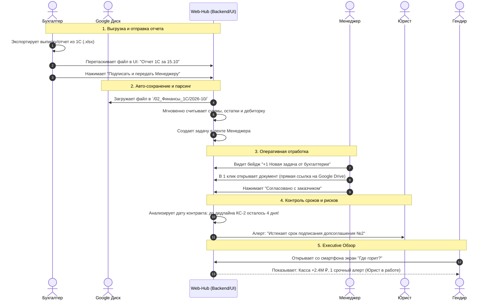

# Архитектурное решение и бизнес-спецификация платформы «Smart Enterprise Hub»
## Операционное управление тендерной компанией на базе Google Диска и автоматического контроля рисков

> **Версия документа**: 1.0 (MVP)
> **Роль**: Старший системный архитектор (Senior Solutions Architect)
> **Целевая аудитория**: Владелец продукта (Бизнес), Техлид, Разработчики, ИИ-агенты
> **Статус**: Утверждено к реализации

---

## 1. Резюме продукта и бизнес-миссия (Executive Summary)

### 1.1. Проблематика бизнеса
Компании, специализирующиеся на участии и исполнении государственных (44-ФЗ, 223-ФЗ) и коммерческих тендеров, ежедневно оперируют десятками разнородных документов и таблиц:
1. **«Синдром замыленного глаза»**: Руководители и специалисты тратят по 2–3 часа в день на открытие 50–100 Excel-файлов в попытках понять: *«Какой статус по тендеру?», «Подписал ли заказчик КС-2?», «Хватает ли денег на спецсчете под обеспечение заявки?», «Где грозит штраф?»*.
2. **Финансовые потери из-за пропущенных дедлайнов**: Опоздание на 1 день с предоставлением обеспечения контракта, банковской гарантии или протокола разногласий приводит к включению в Реестр недобросовестных поставщиков (РНП) и потере обеспечения (от сотен тысяч до десятков миллионов рублей).
3. **Непригодность классических баз данных для нетехнического бизнеса**: Если перенести все файлы в закрытую базу данных (PostgreSQL/S3), собственник и топ-менеджмент теряют прозрачный визуальный контроль. Бизнес требует, чтобы первоисточником оставался привычный **Google Диск**, где в любой момент можно зайти в папку и открыть оригинальный документ.
4. **Ограниченный бюджет**: Внедрение тяжелых систем (1C:ERP, Power BI, Directum) стоит от 300 000 до 3 000 000 ₽ с абонентской платой от 50 000 ₽/мес.

### 1.2. Миссия и формула решения
> **Smart Enterprise Hub** — это легкий операционный пульт управления поверх корпоративного **Google Диска**. Платформа автоматически сканирует папки Google Диска, считывает данные из стандартизированных таблиц, рассчитывает финансовые риски и дедлайны и выводит на экран руководителя и сотрудников простой интерфейс: **«Что нужно сделать прямо сейчас и где горит?»**.

- **Стоимость инфраструктуры**: **до 200–250 рублей в месяц** на всю компанию (запуск на ультралегком VPS в РФ с потреблением < 450 МБ RAM).
- **Интеграция с Google Диском**: 0 рублей (официальный Google Drive API v3, Service Account).
- **Парсинг документов**: детерминированный, 15–30 миллисекунд на файл без платных обращений к LLM.

---

## 2. Ролевая матрица и сквозные пользовательские сценарии (9 Ролей)

Для MVP-версии устанавливаются **единые права доступа** (каждый сотрудник видит систему целиком, что упрощает запуск и снижает затраты на разработку сложных ACL), однако **интерфейс персонализируется под функциональную роль** пользователя через быстрые фильтры и фокусные вкладки.

```
┌────────────────────────────────────────────────────────────────────────┐
│                        РОЛЕВАЯ МОДЕЛЬ КОМПАНИИ                         │
├───────────────────────────────┬────────────────────────────────────────┤
│ УПРАВЛЕНИЕ И СТРАТЕГИЯ        │ 1. Генеральный директор (CEO)          │
│                               │ 2. Зам. генерального директора (COO)   │
├───────────────────────────────┼────────────────────────────────────────┤
│ ПРОИЗВОДСТВО И ТЕНДЕРЫ        │ 3. Тендерный специалист (Тендерщик)    │
│                               │ 4. Инженер ПТО / Главный инженер       │
│                               │ 5. Менеджер проектов / Координатор     │
│                               │ 6. Диспетчер (Логистика и техника)     │
├───────────────────────────────┼────────────────────────────────────────┤
│ ФИНАНСЫ, ЮРИСТЫ И СНАБЖЕНИЕ   │ 7. Главный бухгалтер / Бухгалтер      │
│                               │ 8. Юрист                               │
│                               │ 9. Закупщик / Снабженец                │
└───────────────────────────────┴────────────────────────────────────────┘
```

### 2.1. Детальная матрица ролей и их фокусных зон

| № | Роль | Основная цель роли | Фокусные экраны / Вкладки | Ключевые действия в системе |
| :--- | :--- | :--- | :--- | :--- |
| **1** | **Генеральный директор** | Стратегический контроль за 60 секунд, предотвращение кассовых разрывов и РНП | Экран «Где горит?», Сводка ДДС, Реестр критических рисков | Просмотр свободной ликвидности, мониторинг штрафов, утверждение экстренных оплат |
| **2** | **Зам. гендиректора** | Оперативное управление всеми отделами, снятие блокировок между ролями | Матрица объектов, Экран алертов, Сводный статус тендеров | Контроль сроков, переназначение ответственных, мониторинг выполнения планов |
| **3** | **Тендерщик** | Ведение воронки тендеров, соблюдение сроков подачи и торгов | Вкладка «Тендеры», Календарь процедур, Статусы БГ | Смена статусов закупки, контроль обеспечения заявки, прикрепление документации |
| **4** | **Инженер (ПТО)** | Сдача физических объемов на объектах, подписание КС-2/КС-3 | Вкладка «Объекты СМР», График КС, Загрузка актов | Отметка готовности этапа, прикрепление сканов исполнительной документации |
| **5** | **Диспетчер** | Координация смен, транспорта, механизмов и оперативных заявок | Вкладка «Диспетчеризация», Суточный график | Быстрая фиксация статуса спецтехники/бригад, передача инцидентов инженеру |
| **6** | **Менеджер** | Связующее звено: получение документов от смежников и передача заказчику | Вкладка «Задачи», Карточка проекта, Загрузка файлов | Скачивание отчетов от бухгалтера/инженера, отправка заказчику, закрытие задач |
| **7** | **Юрист** | Контроль условий контрактов, протоколы разногласий, претензионная работа | Вкладка «Юр. контроль», Реестр допсоглашений | Контроль 5-дневного срока протоколов, расчет неустоек, прикрепление претензий |
| **8** | **Закупщик** | Своевременная поставка материалов под график СМР, долги поставщикам | Вкладка «Закупки», График оплат поставщикам | Контроль дефицита материалов, статусы счетов на оплату, фиксация поставок |
| **9** | **Бухгалтер** | Учет движения ДС, выгрузка отчетов из 1С, проведение платежей и ФОТ | Вкладка «Финансы/Касса», Форма быстрой загрузки 1С | Drag-and-drop отчета 1С, передача на оплату, синхронизация с Google Диском |

---

### 2.2. Сквозной рабочий сценарий (End-to-End User Journey)

Ниже представлен реальный ежедневный бизнес-процесс компании без рутинного блуждания по папкам:



1. **Бухгалтер**:
   - Выгружает регулярный отчет взаиморасчетов из 1С.
   - Заходит в веб-интерфейс со смартфона или ПК, перетаскивает файл в форму быстрой загрузки.
   - Выбирает действие: *«Подписать и передать менеджеру»*.
   - **Система автоматически**: сохраняет оригинальный файл на Google Диск в прозрачную корпоративную папку `/02_Финансы_1С/`, парсит показатели за 20 мс, обновляет кассовый баланс и вешает входящую задачу на Менеджера.
2. **Менеджер**:
   - Заходит в свой интерфейс и видит карточку входящей задачи со ссылкой на документ в Google Диске.
   - Не ищет файл по 50 папкам, а скачивает его или открывает прямо в Google Таблицах в один клик.
   - Передает документ заказчику и меняет статус в приложении: *«Отправлено заказчику»*.
3. **Юрист**:
   - Видит уведомление: *«По контракту №44/26 срок подачи протокола разногласий истекает через 48 часов»*.
   - Прикрепляет проект протокола разногласий, система отправляет файл на Google Диск в `/05_Юротдел/`.
4. **Генеральный директор и Зам. гендиректора**:
   - Утром открывают экран «Где горит?».
   - Видят зеленую кассу, 1 желтый алерт по сроку протокола разногласий и статус: *«Юрист уже взял в работу 15 минут назад»*.
   - **Результат**: Ни один дедлайн не упущен, директор спокоен, сотрудники сэкономили часы рабочего времени.

---

## 3. Архитектура интеграции с Google Диском (Google Drive Bridge)

### 3.1. Принцип «Прозрачного файлового хранилища»
Для устранения недоверия бизнеса к IT-системам («куда пропали наши файлы?») применяется гибридная схема:
- **Google Диск** является **мастер-хранилищем файлов** с понятной для любого сотрудника и директора структурой папок.
- **Локальная база данных (PostgreSQL 16 Alpine)** хранит **только легковесные структурированные метаданные**: ID файла на Диске, прямую ссылку (`webViewLink`), дату изменения, вычисленный SHA-256 хеш и распарсенные операционные строки (суммы, даты, ответственные).
- Если сервер выйдет из строя или будет перезагружен — все документы и таблицы остаются в целости и сохранности на Google Диске бизнеса.

```
       ┌────────────────────────────────────────────────────────┐
       │                GOOGLE DRIVE (Бизнес-слой)              │
       │  /Корпоративный Диск Тендерной Компании/               │
       │  ├── 01_Реестры_Тендеров/                              │
       │  ├── 02_Финансы_и_1С/                                  │
       │  ├── 03_Снабжение_и_Закупки/                           │
       │  ├── 04_ПТО_и_Объекты/                                 │
       │  └── 05_Юридический_Отдел/                             │
       └───────────────────────────┬────────────────────────────┘
                                   │
              ┌────────────────────┴────────────────────┐
              │                                         │
    (1) Периодический Polling                 (2) Мгновенный Upload
    (Фоновый опрос 2-4 раза в день)           (Бухгалтер/Менеджер из UI)
              │                                         │
              ▼                                         ▼
 ┌──────────────────────────────────────────────────────────────────────┐
 │                     SMART ENTERPRISE HUB (FastAPI)                   │
 │                                                                      │
 │  [GoogleDriveSyncService] ──> Проверка modifiedTime / MD5             │
 │  [Deterministic Excel Parser] ──> Rust Calamine (< 30 мс)            │
 │  [Alert Engine] ──> Проверка дедлайнов (<= 5 дней) и штрафов         │
 │  [Lightweight SQLite / Postgres] ──> Хранение распарсенных метрик    │
 └──────────────────────────────────┬───────────────────────────────────┘
                                    │
                                    ▼
 ┌──────────────────────────────────────────────────────────────────────┐
 │                    ФРОНТЕНД / МОБИЛЬНЫЙ ИНТЕРФЕЙС                    │
 │  - Экран «Где горит?» (Для Гендира и Зама)                           │
 │  - Смарт-реестр задач со сменой статусов                             │
 │  - Прямые ссылки на открытие документов в Google Drive               │
 └──────────────────────────────────────────────────────────────────────┘
```

### 3.2. Механизм подключения к Google Drive API (0 рублей)
1. В Google Cloud Console создается бесплатный проект и сервисный аккаунт (`service-account@enterprise-hub.iam.gserviceaccount.com`).
2. Генерируется JSON-ключ `credentials.json` (хранится в секретах бэкенда).
3. Администратор компании создает корневую папку на Google Диске и делится ею с email сервисного аккаунта с правами *«Редактор»*.
4. **Финансовые затраты**: **0 рублей** (квота Google Drive API v3 составляет 20 000 бесплатных запросов на 100 секунд, что в 1000 раз превышает потребности компании из 10–50 сотрудников).

### 3.3. Двунаправленный конвейер синхронизации
1. **Входящий конвейер (Google Drive $\rightarrow$ Web App)**:
   - Встроенный планировщик `APScheduler` запускается каждые 3–4 часа (например, в 08:00, 12:00, 16:00, 19:00).
   - Выполняет легковесный запрос `drive.files.list()` с фильтром по дате изменения (`modifiedTime > last_sync_time`).
   - Если файлы не менялись, операция завершается за 0.2 секунды и потребляет 0 байт трафика.
   - Если обнаружен измененный файл: скачивается его поток, вычисляется SHA-256, парсер обновляет метрики в базе, генерируются свежие алерты.
   - Дополнительно в шапке веб-приложения размещается кнопка **«Синхронизировать сейчас»** для мгновенного ручного обновления по требованию.
2. **Исходящий конвейер (Web App $\rightarrow$ Google Drive)**:
   - Когда пользователь (бухгалтер, инженер, закупщик) загружает документ через веб-форму или мобильный телефон:
     - Файл мгновенно заливается в соответствующую целевую папку на Google Диске (`drive.files.create`).
     - Пользователь сразу получает прямую ссылку для открытия в браузере.
     - Создается внутренняя задача с привязкой к документу.

---

## 4. Пять стандартизированных шаблонов Excel (Отказ от дорогого парсера в MVP)

### 4.1. Почему стандартизация лучше динамического AI-парсера в MVP
Динамический эвристический или LLM-парсер, пытающийся угадать хаотичные шапки произвольных таблиц:
- Требует постоянных затрат на токены ИИ.
- Не дает 100% гарантии точности (риск перепутать столбец «Оплачено» и «Остаток долга»).
- Замедляет загрузку до 5–15 секунд на файл.

**Архитектурное решение**: Мы фиксируем **5 эталонных шаблонов Excel**. Компания скачивает их 1 раз, сотрудники ведут учет по утвержденной структуре, а система парсит их со **100% надежностью за 15–30 миллисекунд без единого платного вызова ИИ**.

---

### 4.2. Спецификация 5 утвержденных шаблонов

#### Шаблон 1: `Реестр_Тендеров_и_Контрактов.xlsx`
*Для кого*: Тендерщик, Инженер ПТО, Менеджер, Юрист.
*Папка на Google Диске*: `/01_Реестры_Тендеров/`

| Колонка Excel | Тип данных | Обязательность | Описание и назначение |
| :--- | :--- | :---: | :--- |
| `Номер_Закупки` | Текст | Да | Номер извещения ЕИС / шифр закупки (44-ФЗ / 223-ФЗ) |
| `Наименование_Объекта` | Текст | Да | Название объекта СМР или предмет поставки |
| `Заказчик` | Текст | Да | Наименование заказчика / генподрядчика |
| `Сумма_Контракта_Руб` | Число | Да | Начальная максимальная цена (НМЦК) или цена договора |
| `Сумма_Обеспечения_Заявки` | Число | Нет | Сумма блокировки на спецсчете |
| `Статус_Тендера` | Список | Да | `Подготовка` / `Подано` / `Торги` / `Победа` / `Контракт` / `Отклонено` |
| `Дедлайн_Подачи` | Дата | Да | Крайний срок подачи заявки (триггер алерта) |
| `Дата_Окончания_Работ` | Дата | Да | Финальный срок сдачи объекта по договору |
| `Сумма_Закрыто_КС_Руб` | Число | Нет | Фактически подписанные акты КС-2/КС-3 |
| `Оплачено_Заказчиком_Руб` | Число | Нет | Поступившие оплаты |
| `Куратор_Ответственный` | Текст | Да | ФИО инженера / менеджера |
| `Банковская_Гарантия_До` | Дата | Нет | Срок действия гарантии (контроль сгорания) |

---

#### Шаблон 2: `ДДС_Касса_и_Взаиморасчеты.xlsx`
*Для кого*: Бухгалтер, Генеральный директор.
*Папка на Google Диске*: `/02_Финансы_и_1С/`

| Колонка Excel | Тип данных | Обязательность | Описание и назначение |
| :--- | :--- | :---: | :--- |
| `Дата_Операции` | Дата | Да | Дата фактического или планового платежа |
| `Тип_Операции` | Список | Да | `Поступление` / `Списание` |
| `Статья_ДДС` | Текст | Да | `Аванс_Заказчика`, `Оплата_Поставщику`, `ФОТ`, `Налоги`, `Аренда` |
| `Контрагент` | Текст | Да | Наименование плательщика / получателя |
| `Сумма_Руб` | Число | Да | Сумма операции |
| `Статус_Платежа` | Список | Да | `Факт_Исполнено` / `План_Ожидается` |
| `Расчетный_Счет` | Текст | Нет | Наименование банка / счета |
| `Основание_Платежа` | Текст | Нет | Номер счета, договора или акта |

---

#### Шаблон 3: `План_Закупок_и_Материалов.xlsx`
*Для кого*: Закупщик, Инженер, Менеджер.
*Папка на Google Диске*: `/03_Снабжение_и_Закупки/`

| Колонка Excel | Тип данных | Обязательность | Описание и назначение |
| :--- | :--- | :---: | :--- |
| `Объект_Привязка` | Текст | Да | Наименование объекта строительства / тендера |
| `Наименование_ТМЦ` | Текст | Да | Кабель, арматура, бетон, оборудование и т.д. |
| `Количество_Ед` | Число | Да | Объем закупки |
| `Единица_Изм` | Текст | Да | шт, м, т, м2, компл |
| `Поставщик` | Текст | Да | Компания-поставщик |
| `Сумма_Счета_Руб` | Число | Да | Сумма счета на оплату |
| `Статус_Снабжения` | Список | Да | `Заявка` / `Счет_На_Оплате` / `Оплачено` / `В_Пути` / `На_Объекте` |
| `Срок_Доставки_Дедлайн` | Дата | Да | Дата, к которой материал обязан быть на объекте |

---

#### Шаблон 4: `Диспетчерский_График_и_Техника.xlsx`
*Для кого*: Диспетчер, Инженер.
*Папка на Google Диске*: `/04_ПТО_и_Объекты/`

| Колонка Excel | Тип данных | Обязательность | Описание и назначение |
| :--- | :--- | :---: | :--- |
| `Дата_Смены` | Дата | Да | Дата выполнения работ |
| `Объект_Назначения` | Текст | Да | Место дислокации |
| `Тип_Ресурса` | Список | Да | `Спецтехника` / `Бригада_Рабочих` / `Инженер_Куратор` |
| `Наименование_Единицы` | Текст | Да | Экскаватор JCB, Кран 25т, Бригада монтажников №3 |
| `Ответственный_Водитель_Бригадир`| Текст | Да | ФИО и контактный телефон |
| `Статус_Работы` | Список | Да | `На_Объекте` / `В_Ремонте` / `Простой_Авария` / `Завершено` |
| `Замечания_Инциденты` | Текст | Нет | Причины задержек, простои, поломки |

---

#### Шаблон 5: `Операционные_Задачи_и_Алерты.xlsx`
*Для кого*: Зам. гендиректора, Юрист, Менеджер, Генеральный директор.
*Папка на Google Диске*: `/05_Юридический_Отдел/`

| Колонка Excel | Тип данных | Обязательность | Описание и назначение |
| :--- | :--- | :---: | :--- |
| `Заголовок_Задачи` | Текст | Да | Краткая суть (например: «Подписать допсоглашение №2») |
| `Связанный_Контракт` | Текст | Нет | Номер контракта или объект |
| `Ответственная_Роль` | Список | Да | `Юрист`, `Бухгалтер`, `Менеджер`, `Инженер`, `Закупщик` |
| `ФИО_Исполнителя` | Текст | Да | Конкретный сотрудник |
| `Крайний_Срок_Дедлайн` | Дата | Да | Дата и время дедлайна |
| `Приоритет_Срочность` | Список | Да | `Обычный` / `Высокий` / `КРИТИЧЕСКИЙ_ШТРАФ` |
| `Статус_Исполнения` | Список | Да | `В_Работе` / `На_Проверке` / `Закрыто` |
| `Потенциальный_Штраф_Руб`| Число | Нет | Размер неустойки при срыве срока |

---

## 5. Функциональные блоки приложения

```
┌────────────────────────────────────────────────────────────────────────┐
│             ГЛАВНЫЙ ЭКРАН РУКОВОДИТЕЛЯ: «ГДЕ ГОРИТ?»                   │
├────────────────────────────────────────────────────────────────────────┤
│  [Карточка 1: Свободная Касса]        [Карточка 2: Портфель Контрактов]│
│   2 450 000 ₽                          48 200 000 ₽                    │
│   (Дефицит через 10 дней: 0 ₽)         (12 объектов в работе)          │
├────────────────────────────────────────────────────────────────────────┤
│  [Карточка 3: Нам Должны (Дебиторка)] [Карточка 4: Мы Должны]          │
│   6 800 000 ₽                          3 100 000 ₽                     │
├────────────────────────────────────────────────────────────────────────┤
│  🔥 ПУЛЬСИРУЮЩИЙ БЛОК АЛЕРТОВ (Дедлайны <= 5 дней и риски штрафов)     │
│  🔴 Объект №104: До сдачи КС-2 осталось 3 дня! Штраф: 45 000 ₽         │
│  🟡 Закупка кабеля: Срок поставки истекает завтра (Закупщик)           │
│  🟡 Банковская гарантия: Окончание через 5 дней (Тендерщик)            │
└────────────────────────────────────────────────────────────────────────┘
```

### 5.1. Блок движения денежных средств (ДДС / Cashflow)
- **Прибыло / Убыло**: Агрегированные графики фактических поступлений и списаний за текущий месяц/квартал.
- **Сколько должны (Дебиторка)**: Неоплаченные заказчиками объемы по подписанным КС-2.
- **Сколько должны мы (Кредиторка)**: Счета поставщиков ТМЦ и субподрядчиков с приближающимся дедлайном оплаты.
- **Прогноз кассового разрыва**: Сравнение остатка на расчетных счетах с плановыми списаниями на 14 дней вперед.

### 5.2. Блок контрактов, этапов и дедлайнов
- **Сроки завершения**: Дата окончания СМР / поставки по каждому договору.
- **Статус актирования**: Соотношение суммы контракта к фактически принятым актам КС-2/КС-3.
- **Индикатор просрочки**: Визуальная подсветка в днях (отставание от календарного графика производства работ).

### 5.3. Блок критических алертов («Где горит?»)
- **Правило 5 дней**: Автоматическое включение предупреждения, если до контрольной даты (оплата, подача протокола, подписание акта, продление банковской гарантии) осталось **$\le 5$ рабочих дней**.
- **Калькулятор штрафов по 44-ФЗ / 223-ФЗ**:
  $$\text{Пени} = \text{Несданный объем} \times \frac{1}{300} \text{ Ставки ЦБ РФ} \times \text{Дней просрочки}$$
  Директор видит не просто дату, а **сумму ежедневного финансового ущерба**.

### 5.4. Мобильная адаптивность (Mobile-First)
- Для инженера на объекте и генерального директора в командировке интерфейс адаптируется под экраны смартфонов (вертикальный стек карточек, скрываемые фильтры, крупные кнопки «Подтвердить», нижняя панель навигации).

---

## 6. Архитектурный анализ идеи Канбан-доски

### 6.1. Вопрос бизнеса: «Нужна ли канбан-доска в приложении?»
Бизнес выдвинул гипотезу: сделать отображение задач в виде канбан-доски со столбцами и перетаскиванием карточек для каждого сотрудника.

### 6.2. Экспертная оценка архитектора

```
                   АНАЛИЗ ИДЕИ КАНБАН-ДОСКИ ДЛЯ 9 РОЛЕЙ
┌────────────────────────────────────────────────────────────────────────┐
│ ПЛЮСЫ:                                                                 │
│ - Привычно для менеджеров проектов и маркетологов.                     │
│ - Наглядно для воронки стадий тендера (Подача -> Торги -> Контракт).   │
├────────────────────────────────────────────────────────────────────────┤
│ КРИТИЧЕСКИЕ РИСКИ И МИНУСЫ В РЕАЛЬНОМ БИЗНЕСЕ:                         │
│ 1. ПЕРЕГРУЗ ПОЛЕВЫХ РОЛЕЙ: Диспетчеру и инженеру на стройплощадке      │
│    неудобно таскать карточки пальцем на мобильном телефоне. Им нужен    │
│    простой вертикальный список "Сделать сегодня" с кнопкой "Готово".   │
│ 2. УВЕЛИЧЕНИЕ СРОКА РАЗРАБОТКИ: Реализация Drag-and-Drop на мобильных   │
│    устройствах с обработкой тач-событий увеличивает трудозатраты на    │
│    фронтенд в 2.5–3 раза.                                              │
│ 3. ИЛЛЮЗИЯ КОНТРОЛЯ: Руководитель тонет в десятках столбцов вместо     │
│    ответа на главный вопрос: "Где мы теряем деньги прямо сейчас?".     │
└────────────────────────────────────────────────────────────────────────┘
```

### 6.3. Архитектурный вердикт для MVP
1. **Для версии MVP (Рекомендация)**:
   - **НЕ внедрять тяжелую канбан-доску**.
   - Реализовать **Смарт-реестр с быстрой сменой статусов (Action Stream / Quick Toggles)**:
     - Список задач в 1 клик переключается фильтром: *«Все»*, *«Мои задачи»*, *«Срочные (< 5 дней)»*, *«От бухгалтерии»*.
     - Статус меняется одним кликом по бейджу в таблице (например, выпадающий список: `В работе` $\rightarrow$ `Передано менеджеру` $\rightarrow$ `Закрыто`).
   - Для тендеров реализовать **Линейный степпер воронки (Progress Stepper)** прямо в строке закупки:
     `[Подача] ──> [Допуск] ──> [Торги] ──> [Победа] ──> [Контракт]`.
2. **Для версии v1.2 (Бэклог)**:
   - Добавить переключатель представления `[ Таблица | Канбан ]` исключительно для роли Менеджера и Тендерщика как опциональный вид.

---

## 7. Инфраструктура, стек и расчет стоимости владения (TCO)

Проект полностью опирается на принципы из руководства [zero_overengineering_guide.md](file:///c:/Users/Ivan/Desktop/enterprise%20management/docs/05_tech_stack_and_infrastructure/zero_overengineering_guide.md).

### 7.1. Технологический стек
- **Frontend**: React 18 + TypeScript + Vite + Tailwind CSS + Lucide Icons (сборка в статический HTML/JS, 0 МБ постоянной памяти на сервере).
- **Backend**: Python 3.11+ / FastAPI (асинхронный монолит, библиотеки `openpyxl` и Rust-движок `python-calamine`).
- **База данных**: PostgreSQL 16 Alpine в Docker (тюнинг памяти `shared_buffers = 64MB`, потребление ~110–130 МБ RAM).
- **Файловый мост**: Google Drive API v3 (официальная библиотека `google-api-python-client`).
- **Фоновые задачи**: Встроенный `APScheduler` в процессе FastAPI (без Redis, RabbitMQ и Celery).

### 7.2. Ежемесячный бюджет на инфраструктуру (TCO)

| Компонент | Сервис / Провайдер | Тариф / Параметры | Ежемесячная стоимость |
| :--- | :--- | :--- | :---: |
| **Сервер приложений (VPS в РФ)** | Timeweb Cloud / Beget / Aeza | 1 vCPU, 2 GB RAM, 20 GB NVMe, Ubuntu 22.04 LTS | **180 – 250 ₽** |
| **Хранилище файлов** | Google Drive компании | Google Workspace / Бесплатный Google Диск | **0 ₽** |
| **Google Drive API** | Google Cloud Console | Квота до 20 000 запросов/100 сек | **0 ₽** |
| **База данных** | Локальный PostgreSQL в Docker | Docker Alpine образ | **0 ₽** |
| **SSL-сертификат** | Let's Encrypt / Certbot | Автоматическое продление | **0 ₽** |
| **Уведомления** | Telegram Bot API | Бесплатный шлюз | **0 ₽** |
| **ИТОГО В МЕСЯЦ** | **Полная стоимость содержания системы** | | **~ 200 – 250 ₽ / мес** |

*Сравнение*: Корпоративная лицензия Битрикс24 или 1C:ERP обходится компании от 45 000 до 150 000 ₽ в месяц. Экономия составляет более **99%**.

---

## 8. Пошаговый пайплайн задач для ИИ-агентов (Roadmap)

Данный план предназначен для последовательной передачи задач автономным агентам разработки.

```
┌────────────────────────────────────────────────────────────────────────┐
│                        ПАЙПЛАЙН ЗАДАЧ ДЛЯ АГЕНТОВ                      │
├────────────────────────────────────────────────────────────────────────┤
│ ЭТАП 1: ТЕМПЛЕЙТЫ И МОК-ДАННЫЕ (Data / Template Agent)                │
│ - Генерация 5 файлов .xlsx по утвержденным спецификациям               │
│ - Заполнение реалистичными тестовыми данными для тендерной компании   │
├────────────────────────────────────────────────────────────────────────┤
│ ЭТАП 2: МОДУЛЬ GOOGLE DRIVE И БЭКЕНД-ПАРСЕР (Backend Agent)            │
│ - Сервис GoogleDriveSyncService (Service Account, List, Download)      │
│ - Реализация детерминированного парсера 5 шаблонов на openpyxl         │
│ - Расчет кассы, сроков и алертов (< 5 дней до дедлайна)                │
├────────────────────────────────────────────────────────────────────────┤
│ ЭТАП 3: UI ЭКРАНОВ И МОБИЛЬНАЯ АДАПТАЦИЯ (Frontend Agent)             │
│ - Карточки ДДС, портфеля контрактов и кассового разрыва                │
│ - Пульсирующий блок критических алертов «Где горит?»                   │
│ - Смарт-реестр задач с быстрой сменой статусов                         │
│ - Модальное окно загрузки и передачи документов (сценарий бухгалтера)  │
├────────────────────────────────────────────────────────────────────────┤
│ ЭТАП 4: ИНТЕГРАЦИЯ И СКВОЗНОЕ ТЕСТИРОВАНИЕ (DevOps / QA Agent)        │
│ - Сборка в docker-compose.yml (бэкенд + фронтенд + база)              │
│ - End-to-end проверка сценария "Бухгалтер -> Менеджер -> Google Drive" │
└────────────────────────────────────────────────────────────────────────┘
```

### Детализированный перечень задач для постановки агентам:

#### Блок А: Data & Template Agent
- [ ] **Task D-1**: Сгенерировать 5 эталонных файлов Excel (`Реестр_Тендеров_и_Контрактов.xlsx`, `ДДС_Касса_и_Взаиморасчеты.xlsx`, `План_Закупок_и_Материалов.xlsx`, `Диспетчерский_График_и_Техника.xlsx`, `Операционные_Задачи_и_Алерты.xlsx`) со строгими заголовками, типами данных и валидацией списков.
- [ ] **Task D-2**: Наполнить таблицы 20+ реалистичными строками тендерной компании (живые объекты, горящие дедлайны через 3 и 5 дней, просроченный этап для генерации алерта).
- [ ] **Task D-3**: Сохранить готовые шаблоны в директорию `storage/templates/` и `storage/mock_drive/`.

#### Блок Б: Backend Agent
- [ ] **Task B-1**: Разработать модуль `GoogleDriveClient` (`backend/app/services/google_drive.py`) с методами:
  - `list_changed_files(folder_id, since_time)`
  - `download_file_bytes(file_id)`
  - `upload_file(folder_id, file_name, file_bytes)`
  - `get_web_view_link(file_id)`
- [ ] **Task B-2**: Реализовать детерминированный парсер 5 стандартизированных таблиц в `backend/app/services/template_parser.py`, сопоставляющий колонки с базой данных без вызова LLM.
- [ ] **Task B-3**: Настроить фоновый джоб `APScheduler` на проверку обновлений Google Диска и добавить эндпоинт `POST /api/v1/sync/drive-now`.
- [ ] **Task B-4**: Расширить движок алертов: вычисление штрафов по 44-ФЗ и маркировка событий с дедлайном $\le 5$ дней флагом `CRITICAL`.
- [ ] **Task B-5**: Реализовать эндпоинт загрузки бухгалтера `POST /api/v1/files/upload-and-assign` с сохранением на Google Диск и автоматическим созданием задачи для Менеджера.

#### Блок В: Frontend Agent
- [ ] **Task F-1**: Доработать главный экран «Сводка» (`DashboardTab.tsx`):
  - 4 ключевые KPI-карточки (Касса, Портфель, Дебиторка, Кредиторка).
  - Красный пульсирующий блок «Где горит?» (список алертов $\le 5$ дней с суммой штрафа).
- [ ] **Task F-2**: Создать компонент «Смарт-реестр задач» с быстрой сменой статусов без тяжелого канбана (`В работе`, `Передано менеджеру`, `Закрыто`) и ссылками на Google Drive.
- [ ] **Task F-3**: Реализовать форму загрузки отчета бухгалтера с drag-and-drop и кнопкой «Подписать и передать менеджеру».
- [ ] **Task F-4**: Добавить кнопку «Синхронизировать с Google Диском» в шапку с отображением времени последней проверки.
- [ ] **Task F-5**: Обеспечить адаптивность под мобильные экраны (Mobile viewport для инженера и диспетчера).

#### Блок Г: DevOps & QA Agent
- [ ] **Task QA-1**: Проверить запуск всего контура через `docker-compose up`.
- [ ] **Task QA-2**: Провести сквозной тест: добавление новой строки в Excel на Google Диске $\rightarrow$ запуск синхронизации $\rightarrow$ мгновенное появление критического алерта в мобильном дашборде.
- [ ] **Task QA-3**: Проверить бюджет оперативной памяти: суммарное потребление не должно превышать 450 МБ RAM.
